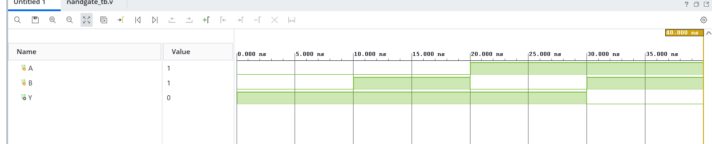

```markdown
# NAND Gate

## Objective
Design and simulate a 2-input NAND gate using Verilog HDL.

## Description
The NAND gate (NOT-AND) is a universal digital logic gate. It produces a LOW (`0`) output only when **both inputs are HIGH (`1`)**. For all other input combinations, the output remains HIGH (`1`). Since any digital logic circuit can be implemented using only NAND gates, it is widely used in digital electronics.

## Truth Table

| A | B | Y |
|:-:|:-:|:-:|
| 0 | 0 | 1 |
| 0 | 1 | 1 |
| 1 | 0 | 1 |
| 1 | 1 | 0 |

## Verilog Files

- `nand_gate.v` – Verilog module implementing the NAND gate.
- `nand_gate_tb.v` – Testbench used to verify the design.

## Simulation

The design was simulated using **Xilinx Vivado**. The simulation waveform confirms that the output is LOW only when both inputs are HIGH, matching the NAND gate truth table.

## Software Used

- Xilinx Vivado
- Verilog HDL

## Applications

- Universal gate for implementing any digital logic circuit
- Flip-flop and latch design
- Memory circuits
- Clock gating and control logic
- Digital control systems

## Result

The 2-input NAND gate was successfully designed, simulated, and verified. The simulation results matched the expected logical behavior.

## Simulation Waveform


```
