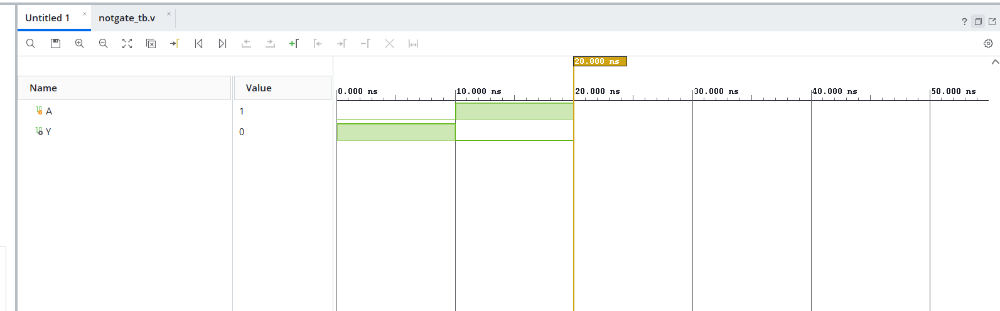

```markdown
# NOT Gate

## Objective
Design and simulate a NOT gate (Inverter) using Verilog HDL.

## Description
The NOT gate, also known as an **Inverter**, is the simplest digital logic gate. It produces the **complement** of the input. If the input is LOW (`0`), the output becomes HIGH (`1`), and if the input is HIGH (`1`), the output becomes LOW (`0`).

## Truth Table

| A | Y |
|:-:|:-:|
| 0 | 1 |
| 1 | 0 |

## Verilog Files

- `not_gate.v` – Verilog module implementing the NOT gate.
- `not_gate_tb.v` – Testbench used to verify the design.

## Simulation

The design was simulated using **Xilinx Vivado**. The simulation waveform confirms that the output is always the logical complement of the input for all possible input values.

## Software Used

- Xilinx Vivado
- Verilog HDL

## Applications

- Signal inversion
- Active-low control signals
- Complement generation
- Digital arithmetic circuits
- Logic optimization and combinational circuit design

## Result

The NOT gate was successfully designed, simulated, and verified. The simulation results matched the expected inverter operation.

## Simulation Waveform


```
