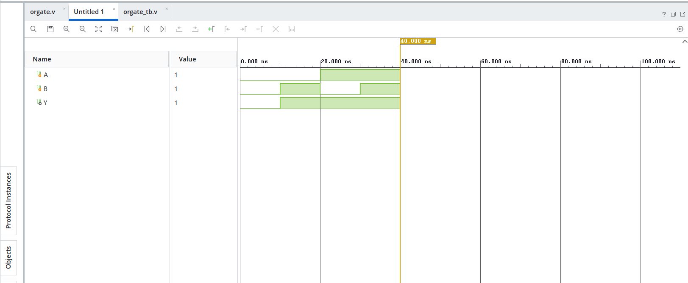

```markdown
# OR Gate

## Objective
Design and simulate a 2-input OR gate using Verilog HDL.

## Description
The OR gate is a fundamental digital logic gate. It produces a HIGH (`1`) output when **at least one of the inputs is HIGH (`1`)**. The output is LOW (`0`) only when **both inputs are LOW (`0`)**.

## Truth Table

| A | B | Y |
|:-:|:-:|:-:|
| 0 | 0 | 0 |
| 0 | 1 | 1 |
| 1 | 0 | 1 |
| 1 | 1 | 1 |

## Verilog Files

- `or_gate.v` – Verilog module implementing the OR gate.
- `or_gate_tb.v` – Testbench used to verify the design.

## Simulation
The design was simulated using **Xilinx Vivado**. The simulation waveform verifies that the output follows the OR gate truth table for all possible input combinations.

## Software Used

- Xilinx Vivado
- Verilog HDL

## Applications

- Alarm and security systems
- Interrupt generation
- Control logic circuits
- Data selection circuits
- Digital decision-making systems

## Result

The 2-input OR gate was successfully designed, simulated, and verified. The simulation results matched the expected logical behavior.

## Simulation Waveform


```
